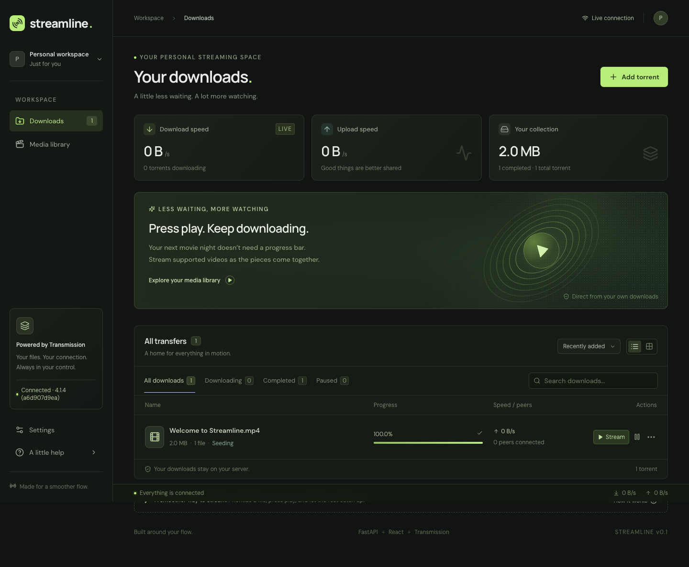
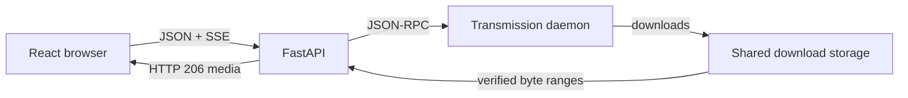

# Streamline

A personal torrent downloader and media streaming app built with **FastAPI**, **Vite + React + TypeScript**, and [Transmission](https://github.com/transmission/transmission).

Add a magnet link or `.torrent`, manage your transfers, and play supported video and audio in the browser. Transfer progress arrives through a shared Server-Sent Events connection. All downloading and seeding is handled by a real Transmission daemon.



## Start with Docker

Requires Docker with Compose. From this repository:

```sh
cp .env.example .env
docker compose up --build -d
```

Open **http://localhost:8000**. FastAPI serves the built React application and the API on the same origin. The web port binds to loopback by default. Transmission RPC is available only inside the Compose network; its peer port is 51413 TCP/UDP.

```sh
docker compose logs -f app transmission
docker compose down
```

Downloads and Transmission configuration survive restarts in named Docker volumes. `docker compose down` preserves these volumes.

To enable a workspace login, set `APP_PASSWORD` and a random `SESSION_SECRET` in `.env`, then recreate the app with `docker compose up -d`. For remote access, use an HTTPS reverse proxy, enable `SECURE_COOKIES`, and set explicit `ALLOWED_HOSTS` and `ALLOWED_ORIGINS` for your domain. The default configuration is intended for a personal local workspace, with one shared Transmission library.

## Local development

Requires **Python 3.12–3.14**, [uv](https://docs.astral.sh/uv/), **Node.js 22.12+** (24 recommended), and either Docker or an existing Transmission daemon. The lockfile is generated with Python 3.13.

Start the development daemon from the repository root. Avoid running the production and development Compose projects together because their peer ports overlap.

```sh
docker compose -f compose.dev.yaml up -d
cp backend/.env.example backend/.env
```

In one terminal:

```sh
cd backend
uv sync --group dev
uv run uvicorn app.main:app --reload --host 127.0.0.1 --port 8000
```

In another terminal:

```sh
cd frontend
npm ci
npm run dev
```

Open **http://localhost:5173**. Vite proxies `/api` to FastAPI. API documentation is at **http://localhost:8000/docs**.

For an existing daemon, edit `backend/.env` with its RPC URL and credentials. **FastAPI must see the same files at the same absolute paths as Transmission**. `DOWNLOAD_DIR` defines the allowed streaming root and the location for newly added torrents. The development Compose file mirrors the repository's absolute download path into the container; run it from the repository root. An existing torrent outside that root can be managed, but cannot be streamed by this app.

## What works

- Magnet links and bounded `.torrent` file uploads, with duplicate detection.
- Live download/upload rates, completion, peer counts, and download statuses.
- Pause, resume, verify, remove, and explicit opt-in deletion of downloaded data.
- File selection and low/normal/high download priority.
- Search, status filters, sorting, list/grid layouts, and a media library.
- Native browser video/audio player with HTTP byte ranges, seeking, buffering feedback, and retry.
- Sequential downloading on Transmission 4.1+; protocol negotiation and ordinary download controls on older daemons.
- Persistent daemon bandwidth limits and download queue settings.
- Responsive navigation, keyboard-accessible dialogs, and optional password login using an HttpOnly cookie.

## How streaming works



Here, “live streaming” means **watching torrent media while it downloads**. It is progressive HTTP playback, with live transfer updates. It does not broadcast a live camera feed or generate an HLS stream.

Before playback, Streamline prioritizes the chosen file and enables sequential downloading on a capable daemon. For each byte range, it checks Transmission's **verified-piece bitfield**. Sparse-file size and aggregate completion alone cannot establish that the requested bytes are available. Missing initial pieces produce a retryable `503`; later gaps wait up to `STREAM_WAIT_SECONDS` before the connection ends and the player can retry. Unverified sparse bytes are never intentionally sent.

MP4/H.264/AAC and WebM are useful starting formats; actual support depends on the browser's codecs. MP4 files with their index at the end may need the final pieces before playback starts. Seeking into an undownloaded area can buffer or require a retry. There is no server-side transcoding. MKV and other unsupported containers can be saved for an external player. Transmission 3/4.0 supports file priority but not sequential mode, so early playback is less predictable.

The included Docker initialization keeps incomplete data beside the final file in the shared directory. For an external daemon with a separate incomplete directory, keep it under the shared `DOWNLOAD_DIR`; Streamline reads that location from the daemon. Files can also use Transmission's `.part` suffix. Only files reported by the daemon and contained inside the allowed root are served.

The adapter follows Transmission's [current RPC specification](https://github.com/transmission/transmission/blob/4.1.4/docs/rpc-spec.md) and its [legacy RPC specification](https://github.com/transmission/transmission/blob/4.0.6/docs/rpc-spec.md), including the session-ID challenge and stable torrent hash IDs.

## Try an original local sample

For the **development setup**, install FFmpeg and run from the repository root:

```sh
python3 scripts/create_sample.py --register
```

This generates a 12-second test video, copies it into the shared download directory, and creates/registers its torrent. The existing local data is verified by Transmission. It does not download content from a public swarm. Open the app and click **Stream**. The files are under ignored `data/`.

Without `--register`, upload `data/fixtures/welcome.torrent` through the interface yourself. The script expects the default development paths and an app without `APP_PASSWORD`.

## Validation

Backend tests use temporary files and a mocked RPC transport to cover protocol negotiation, the session challenge, byte ranges, missing pieces, file containment, authentication, origin validation, upload limits, and controls:

```sh
cd backend
uv run pytest -q
uv run ruff check app tests
uv run ruff format --check app tests
```

Frontend type check and production build:

```sh
cd frontend
npm run build
```

After starting the development services and registering the sample, run real-daemon smoke checks:

```sh
python3 scripts/smoke.py
# Also verify an actual throttled local webseed download and playback before completion:
python3 scripts/smoke.py --transfer
```

`--transfer` temporarily serves only the generated sample on port 8766 so the Docker daemon can reach it via `host.docker.internal`. For a host-native daemon, add `--webseed-host 127.0.0.1`. It removes its disposable torrent afterward and preserves downloaded data.

Desktop/mobile browser checks require the running services and registered sample:

```sh
cd frontend
npx playwright install chromium
npm run test:e2e
# Or use an installed Chrome:
PLAYWRIGHT_CHANNEL=chrome npm run test:e2e
```

The browser tests exercise actual playback, upload, file details, pause/resume, filters, search, media navigation, settings persistence, and the removal dialog. Screenshots are written to `docs/`; traces and failures go to ignored `test-results/`. See [the validation record](docs/validation.md) for the checks performed on this build.


## Project layout

```text
backend/app/           FastAPI routes, RPC adapter, shared state hub, streaming
backend/tests/         API, protocol, range, and integrity tests
frontend/src/          React components, live-state hook, types, styling
frontend/tests/        Playwright desktop/mobile flows
scripts/              Original sample generation and real-daemon smoke checks
compose.yaml          Full production-style local stack
compose.dev.yaml      Transmission with host-visible shared paths
Dockerfile            React build + non-root FastAPI runtime
docs/                 Verified application screenshots
```

Transmission retains torrent state, queue settings, and resume information. Streamline adds no separate database. This first version has a single shared workspace; multi-user libraries, adaptive bitrate streaming, transcoding, and distributed deployments are outside its current scope.
